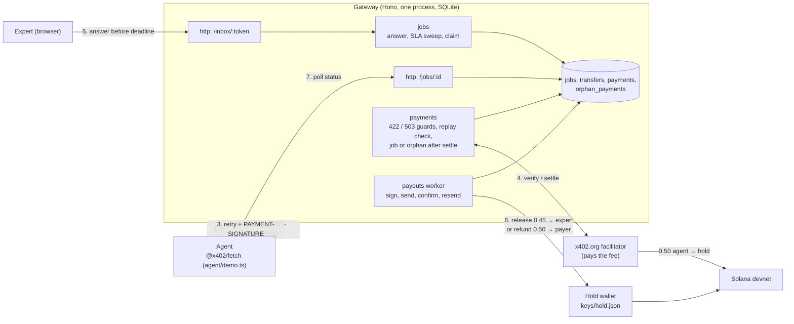

# HumanRoute

An AI agent that is unsure about a translation pays a human expert $0.50 per question over plain HTTP, using x402 on Solana devnet. The gateway holds the payment in a hot hold wallet. If the expert answers before the SLA deadline (default 60 s), 90% is released to the expert. If the expert stays silent, the agent gets a full refund to the paying wallet. Both outcomes are ordinary on-chain SPL transfers with a memo `hr:<jobId>`, and the agent sees "released" or "refunded" only once that transfer is `confirmed`. This is a hackathon demo, devnet only.

> **Status**
>
> **Verified on devnet by the spike** (2026-10-20, [`spike/REPORT.md`](spike/REPORT.md), throwaway code, not the gateway):
>
> | Claim | Result | Evidence |
> | --- | --- | --- |
> | x402 `exact` payment of 0.50 to the hold wallet via the x402.org facilitator; facilitator pays the fee | Works | [31R1kGMq…](https://explorer.solana.com/tx/31R1kGMqhUczbBHhgHCKBGCcPEgWprvSyXZYCeVpeHNf5nrnniHqjD8zeSn729KFzEsyp6BieXmBQGXKSJ6SjbKe?cluster=devnet), settle call 1048 ms |
> | Settle response `payer` = paying wallet = on-chain `transferChecked.authority` | Yes | same tx; `DBwaYVM1f1ETACMBFgT3UoQJgV5CMCNhPmVLD9myMJLt` |
> | Refund hold → payer with memo | Works | [2nYLzgNM…](https://explorer.solana.com/tx/2nYLzgNMKD68meFmJiQUFb8RaEQfMbMaNdCU5DuSemGPRnqXaEi2hCQXxE8NUnkFeBrmDqeQsdikvMvPWbEL9HQ4?cluster=devnet), send → confirmed 810 ms |
> | Replay of a byte-identical `PAYMENT-SIGNATURE` | Rejected by the facilitator (402), no second debit | first send [3QqVHyhm…](https://explorer.solana.com/tx/3QqVHyhmeWxYmbNp4Uurm9MKChet1n4idDZKSFKvnUgzPvhMMqSVRCiEuWDCZyzEVoXdHo1S7k8d3KcQc7BvhFFK?cluster=devnet), replay → 402 in 234 ms |
> | Underpayment (0.10 instead of 0.50) | Rejected locally (402) before any facilitator call | 2 ms, no debit |
>
> The spike paid with the SPL **test mint** `FeyjUFJCsrdmRB7vJQqCtCXTxgKD11DfYqacVDDGRw2c` because the Circle faucet had not delivered yet. Later the same day the faucet delivered 20 devnet USDC and both demo scenarios were repeated on **real devnet USDC** `4zMMC9srt5Ri5X14GAgXhaHii3GnPAEERYPJgZJDncDU`: see the first two rows of [Devnet run](#devnet-run).
>
> **The gateway itself** (this repo's `src/`) against devnet: see [Devnet run](#devnet-run).

## Devnet run

Measured on 2026-10-20 against this repo's gateway (`npm start`, SLA 60 s, price 0.50, facilitator `https://x402.org/facilitator`). The first two rows use real devnet USDC `4zMMC9srt5Ri5X14GAgXhaHii3GnPAEERYPJgZJDncDU`; the rest were run earlier with the test mint `FeyjUFJCsrdmRB7vJQqCtCXTxgKD11DfYqacVDDGRw2c`, which stays the fallback when no USDC faucet is reachable. Timings are wall-clock from the agent's point of view, taken from the demo output and the server log.

| Scenario | Result | Signature | Timing |
| --- | --- | --- | --- |
| **devnet USDC**: `npm run demo`, expert answers, release 0.45 USDC | `released`; agent 20 → 19.5, expert 0 → 0.45, hold 0 → 0.05 USDC | payment [67p8AF27…](https://explorer.solana.com/tx/67p8AF27hcJHrsQKgW3WbbRwMips91dCMqyJ6wBm92HSKwhwh1YNksE1uf6keinkgrusDcLjfM1DyYzvkyWzs9ys?cluster=devnet), release [5VYEYFWq…](https://explorer.solana.com/tx/5VYEYFWqrXBMbY45tcg8TeL1WiTffrxqH6KA89YZwRjJPUuvEG6qhKcHP45enaLam6FwoTEguqDYBAM7b3AXjVsq?cluster=devnet) | `releasing` at +4 s, `released` (confirmed) at +8 s |
| **devnet USDC**: `npm run demo:silent`, refund 0.50 USDC | `refunded`, `sla_expired`, exit 0 | payment [56E9PXQV…](https://explorer.solana.com/tx/56E9PXQVhRDyEk2wqX5bsfUuoE7PcMikBDotrfL572hMK8VhDZm9RAUgzXfmaszmfmNBFjTehvCbbAtAVwRvvMmk?cluster=devnet), refund [23m5LZf3…](https://explorer.solana.com/tx/23m5LZf39oXXxoZ5iRdn3X4EbYSFbkfWKUJhwxXxSm1BWhRdFFrTnKDYEbp6c7DevkZb9xrDX3j7SoAtiD8r6HTg?cluster=devnet) | `refunding` at +62 s, `refunded` (confirmed) at +64 s, 69 s end to end |
| Paid escalation (`npm run demo`), x402 settle → `202` | ok, job `paid`, payer = agent wallet | [2fqFPQbY…](https://explorer.solana.com/tx/2fqFPQbYNP7y55awMAJRKVhQVmb17QtJmNA8fWxprYZSTAhuCfYDUCvQ4U9iM3ycuaDh4P8hDTHE3w9ReQPam8cf?cluster=devnet) | ~2 s from first request to `202` |
| Expert opens the inbox and answers, release 0.45 to expert | ok, `released`, expert balance 0 → 0.45, hold keeps 0.05 | [2DMpUuXw…](https://explorer.solana.com/tx/2DMpUuXwbxPpZMoH5n2sbjjkMRqyPDJq3zvsy8iqMMHJ1WUQXZdrLG5u67zmSZ97NjAA7FDFLt9UzqfHiVW9F2t9?cluster=devnet) | answer at +10 s, `releasing` at +12 s, `released` (confirmed) at +14 s |
| Second answer to the same job | `409`, job unchanged | — | — |
| Expert silent (`npm run demo:silent`), refund 0.50 to payer | ok, `refunded`, `refund_reason: sla_expired`, exit 0 | payment [4HhogNBf…](https://explorer.solana.com/tx/4HhogNBfEDYtdeVyYD5VFbAq16Xy8znRu1DjcUsEsVuFUkpsahPBzqPciA4dRUBE2gxFmvs2Jmqi3ZDu5KYqzioJ?cluster=devnet), refund [35TMEDYo…](https://explorer.solana.com/tx/35TMEDYoK97KJS6TZFx7PxidjnLi9LrdurWgUwC9TiyDWYRskqk4CGeSA7hsqdnekVvS3TYCroF2eP9EjfdcUsW8?cluster=devnet) | `refunding` at +62 s, `refunded` (confirmed) at +64 s, 66 s end to end |
| Replay, same `PAYMENT-SIGNATURE` + same body (twice) | `202` with the same `jobId`, no second settle, no second charge | — | immediate, before the facilitator is called |
| Replay, same `PAYMENT-SIGNATURE` + other body | `409 payment already used for a different request` | — | immediate |
| `npm run e2e:devnet` (own server on a free port, silent agent) | `PASS: refund confirmed within SLA+90s`, exit 0 | payment [2sr36nHP…](https://explorer.solana.com/tx/2sr36nHPwc757R7SBzbWFCD88pt9VEM7Ctg5uwKF1QpSHoCC8EJMbUCdcEKaCJG7koszFEtYuUVFrjReV9Abo9m3?cluster=devnet), refund [3SpBneB7…](https://explorer.solana.com/tx/3SpBneB7Fx2oDWM3hjmw6tEcRCsT8cd82a1forZ3HKqwsquXoF2m53oNmjCN6aDuaMcgw1sGjWGWFnWo3vHuznKw?cluster=devnet) | 68 s including server start |
| Gateway killed 2 s after the refund was broadcast, then restarted | the `sent` row was recovered by signature status: same signature confirmed, no second send | refund [2s9f27T8…](https://explorer.solana.com/tx/2s9f27T8n2PJf7VzxaEsZoCA7Kt2ASshjHm2JUgyCaoYhHCWuoe3Q1vFo3WiSJDUthhDxz3d5dSSUgzL?cluster=devnet) | confirmed ~8 s after restart |
| Expert wallet without a token account | release → `failed`, `OPERATOR ACTION REQUIRED` in the log, status `releasing` with `last_error`; after creating the ATA `npm run requeue -- <id>` → `pending` → sent → `confirmed`; a second requeue is refused (exit 2) | release [3wfM3uFo…](https://explorer.solana.com/tx/3wfM3uFoZypN1sXupYHzeeoCvvV2NdjiYUZyY8ZmLXuJw4juP7v6pd4CiESuFw23NnCEkKxTVBdiurt?cluster=devnet) | confirmed ~10 s after requeue |
| Preflight failing on devnet (wrong mint) | server stays up, `/health` `ready:false`, `POST /x/translate` → `503 not_ready` with reasons (no URLs), log `payouts paused` | — | — |
| Database from an older schema | startup refused: `legacy database at <path>: delete it or set DB_PATH`, exit 1 | — | — |

Not covered by this run: orphan payments on devnet (only smoke-tested with a forged settle header), RPC outage during a payout.

## Architecture



A job is created only after the facilitator settles, keyed by the settlement signature. The decision (`jobs.state`: `paid → answered → released`, or `paid → refunded`) and the money movement (`transfers.status`: `pending → sent → confirmed | failed`) are tracked separately, with exactly one transfer per job (unique index). Full request flow, state machine and failure table: [`docs/design/flow.md`](docs/design/flow.md).

Modules ([ADR 0009](docs/adr/0009-module-layout.md)); `src/index.ts` wires them together:

| Module | Owns | May import |
| --- | --- | --- |
| `config` | Env and keypair parsing into `Config` | none |
| `store` | SQLite handle, migrations, job/transfer/payment rows | `config` |
| `chain` | Solana RPC client interface, transfer build/sign, status, memo lookup | `config` |
| `jobs` | Job lifecycle: answer, SLA sweep, claim (decision + transfer intent) | `store` |
| `payments` | x402 route, payment id, fingerprint, job creation after settle | `store`, `config` |
| `payouts` | Worker: sign, send, confirm, resend policy | `store`, `chain`, `jobs` |
| `http` | Hono app, inbox, status views | `payments`, `jobs`, `store` |

Only `src/payouts/` sends transactions. `agent/` (demo agent) and `scripts/` (wallet setup, e2e) live outside `src/`.

## Run from a clean clone

Requires Node >= 22.12 and devnet only.

1. Install dependencies:

   ```
   npm ci
   ```

2. Create the wallets and the demo test mint. This creates `keys/hold.json`, `keys/agent.json`, `keys/expert.json` (mode 0600), tries to airdrop devnet SOL to hold and agent, creates a 6-decimal test mint with the hold wallet as mint authority (`keys/test-mint.json`), creates the token accounts and mints 100 test tokens to the agent. It is idempotent.

   ```
   npm run setup:wallets -- --fallback-mint
   ```

3. Fund **hold** with devnet SOL at <https://faucet.solana.com> if the airdrop was rate limited (hold pays for token accounts, payouts and refunds). The agent needs no SOL to pay: the facilitator pays the network fee. Re-run step 2 after funding if it stopped early.

4. Configure:

   ```
   cp .env.example .env
   ```

   In `.env`:
   - `USDC_MINT`: devnet USDC `4zMMC9srt5Ri5X14GAgXhaHii3GnPAEERYPJgZJDncDU` if you can fund the agent at https://faucet.circle.com (Solana Devnet, no account, reCAPTCHA); otherwise the test mint printed by step 2 (stored in `keys/test-mint.json`), e.g. `FeyjUFJCsrdmRB7vJQqCtCXTxgKD11DfYqacVDDGRw2c` on the maintainer's machine. Any 6-decimal SPL mint works ([ADR 0015](docs/adr/0015-devnet-test-mint-for-the-demo.md)).
   - `INBOX_TOKEN` and `STATUS_SECRET`: at least 12 characters each, e.g. from `openssl rand -hex 16`.
   - `EXPERT_WALLET` may stay empty: the public key of `keys/expert.json` is used.

5. Make sure the keypair files are private. Startup refuses group- or world-readable keys:

   ```
   chmod 600 keys/*.json
   ```

6. Start the gateway:

   ```
   npm run dev
   ```

   Invalid config exits 1. A failing preflight (hold lacks SOL or its token account, facilitator does not list devnet) does not stop the server: `/x/translate` answers `503` with the reasons and the check re-runs every 60 s. A database from an older schema is rejected with `legacy database at <path>: delete it or set DB_PATH`.

7. In a second terminal, run the demo agent. It "translates" a 3-sentence contract with a fake MT and escalates the least confident sentence over x402.
   - `npm run demo`: open the printed inbox link (`/inbox/<INBOX_TOKEN>`) and submit a translation before the deadline. The agent waits for the confirmed payout and prints the answer.
   - `npm run demo:silent`: nobody answers. After `SLA_SECONDS` the worker refunds the payer and the agent prints `refund [confirmed]` with an explorer link.

8. Optional, real devnet, needs `.env` and `keys/`: `npm run e2e:devnet` starts the gateway on a free port, runs the silent demo and passes only on a confirmed refund within `SLA_SECONDS + 90` s. Exit 0 pass, 1 fail, 2 missing prerequisites. It is not part of `npm run check` ([ADR 0011](docs/adr/0011-devnet-e2e-outside-check.md)).

9. Operator, when a transfer is `failed` (the log shows `OPERATOR ACTION REQUIRED transfer <id> job <jobId>: <error>`): fix the cause (fund hold, create the recipient token account), then:

   ```
   npm run requeue -- <transferId or jobId>
   ```

   Requeue moves `failed` back to `pending` only if nothing was broadcast, or the stored signature is unknown to the chain, its blockhash has expired and no memo `hr:<jobId>` is found. Otherwise it refuses and changes nothing. It never sends; the running worker does ([ADR 0017](docs/adr/0017-operator-requeue-of-failed-transfers.md)).

| Script | What it does |
| --- | --- |
| `npm run check` | Biome check + `tsc --noEmit`; must pass before every commit |
| `npm run fix` | Biome check with `--write` |
| `npm run typecheck` | `tsc --noEmit` only |
| `npm run dev` | Gateway with `.env`, restarts on change |
| `npm start` | Gateway with `.env` |
| `npm run setup:wallets` | Idempotent wallet, ATA and (with `-- --fallback-mint`) test mint setup |
| `npm run demo` | Demo agent, expert answers |
| `npm run demo:silent` | Demo agent, expert silent, expects a refund |
| `npm run e2e:devnet` | Opt-in real-devnet run of the silent flow |
| `npm run requeue -- <id>` | Operator: requeue a `failed` transfer under safety checks |

## curl walkthrough

**1. Unpaid request → 402.**

```
curl -si -X POST http://localhost:4021/x/translate -H 'content-type: application/json' -d '{"text":"Hello world","sourceLang":"en","targetLang":"de"}'
```

The response is `402 Payment Required` with a base64 `PAYMENT-REQUIRED` header. Decode it:

```
curl -si -X POST http://localhost:4021/x/translate -H 'content-type: application/json' -d '{"text":"Hello world","sourceLang":"en","targetLang":"de"}' | grep -i '^payment-required' | cut -d' ' -f2 | tr -d '\r' | base64 -d | jq
```

Decoded header as captured on devnet by the spike server ([`spike/fixtures/402.json`](spike/fixtures/402.json)). The gateway sends the same shape; its `resource` carries its own URL and the description `Human translation job`:

```json
{
  "x402Version": 2,
  "error": "Payment required",
  "resource": {
    "url": "http://localhost:4402/x/translate",
    "description": "Human translation job (spike)",
    "mimeType": "application/json"
  },
  "accepts": [
    {
      "scheme": "exact",
      "network": "solana:EtWTRABZaYq6iMfeYKouRu166VU2xqa1",
      "amount": "500000",
      "asset": "<USDC_MINT>",
      "payTo": "GA2zTLgnzac8zdr2VZBLC7FchaLJbz3MARnzBRkdUFmr",
      "maxTimeoutSeconds": 300,
      "extra": { "feePayer": "CKPKJWNdJEqa81x7CkZ14BVPiY6y16Sxs7owznqtWYp5" }
    }
  ]
}
```

`asset` is the mint configured in `USDC_MINT` (the spike used the test mint `FeyjUFJCsrdmRB7vJQqCtCXTxgKD11DfYqacVDDGRw2c`). `amount` is in base units with 6 decimals: `500000` = 0.50. `payTo` is the hold wallet; on your clone it is your `keys/hold.json`. An invalid body gets `422` and never a 402, so a bad request is never charged.

**2. Paid request → 202.** `@x402/fetch` (see `agent/escalate.ts`) signs a matching transfer and retries with `PAYMENT-SIGNATURE`. After settlement the gateway answers `202` with a `PAYMENT-RESPONSE` header (`{success, transaction, payer, network}`) and:

```json
{
  "jobId": "<jobId>",
  "statusUrl": "/jobs/<jobId>?token=<statusToken>",
  "statusToken": "<statusToken>"
}
```

The status token is an HMAC of the job id with `STATUS_SECRET`. `/jobs/<jobId>/view?token=…` is an auto-refreshing HTML view of the same status.

**3. Status.** `curl -s "http://localhost:4021/jobs/<jobId>?token=<statusToken>"`. Example shape for a silent expert after the refund confirmed (signature and deadline are placeholders; `deadline_at` is a number in epoch ms):

```json
{
  "state": "refunded",
  "refund_reason": "sla_expired",
  "viewed_at": null,
  "deadline_at": "<epoch ms>",
  "answer": null,
  "transfers": [
    {
      "kind": "refund",
      "status": "confirmed",
      "tx_sig": "<refund signature>",
      "attempts": 1,
      "last_error": null,
      "explorer_url": "https://explorer.solana.com/tx/<refund signature>?cluster=devnet"
    }
  ]
}
```

Public `state` ([ADR 0018](docs/adr/0018-public-job-state-and-payout-progress.md)):

| State | Meaning |
| --- | --- |
| `paid` | Payment settled, waiting for the expert |
| `answered` | Expert answered in time, payout not yet claimed |
| `releasing` | Payout decided, transfer `pending`, `sent` or `failed` |
| `refunding` | Refund decided, transfer `pending`, `sent` or `failed` |
| `released` | Payout transfer `confirmed`; `answer` is now shown |
| `refunded` | Refund transfer `confirmed` |

A stuck transfer is visible: `releasing`/`refunding` with `status: "failed"` and `last_error`.

## Failure handling

From [`docs/design/flow.md`](docs/design/flow.md):

| Situation | Behavior |
| --- | --- |
| No payment header | `402` with `PAYMENT-REQUIRED`. Nothing is stored. |
| Invalid request body | `422` before any payment is requested. |
| Same `PAYMENT-SIGNATURE` again, same body (before or after payout/refund) | Same `202` with the same `jobId`. No second settlement, payout or refund. |
| Same payment, different body | `409` (fingerprint mismatch). No new job. |
| Underpayment, wrong mint or network | Verification fails, new `402`, no state change. |
| Facilitator error or timeout at settle | No job is created; the agent gets an error and may retry with the same header. |
| Settled, but header unparsable, wrong network, invalid `payer` or job insert failed | Orphan payment: `transaction` and `payer` logged first, row in `orphan_payments`, `502 {error: "orphan_payment", payTx}`. Operator refunds by hand ([ADR 0016](docs/adr/0016-orphan-payments.md)). |
| Expert silent past the SLA | Sweep claims `refunded`; refund of the full price to the payer with memo `hr:<jobId>`. |
| Expert answers after the deadline | `409`; job stays `refunded`. |
| Retryable RPC error during payout (429, timeout, `BlockhashNotFound`) | Back to `pending`, bounded attempts with backoff. |
| Crash after claim, before send | `pending` row is picked up on restart and sent once. |
| Restart after broadcast | Stored signature is checked; a new transaction only after blockhash expiry and no memo match. |
| Preflight failing (hold lacks SOL or token account, facilitator does not list devnet) | Server keeps running; `/x/translate` answers `503` with the reasons, no payment taken; re-check every 60 s. |
| Final error (recipient token account missing, insufficient funds) | Transfer `failed` with `last_error`, log `OPERATOR ACTION REQUIRED`; operator fixes the cause and runs `npm run requeue -- <id>`. |

Open orphans: `SELECT * FROM orphan_payments WHERE resolved_at IS NULL;`. The operator checks the transaction on-chain, refunds by hand, then sets `resolved_at`. The gateway never refunds orphans automatically.

"Released"/"refunded" mean `confirmed` commitment, not `finalized`. No fixed latency is promised; measured spike numbers are in the Status box.

## Custody and security

- **Devnet only.** Do not use with real funds or on mainnet. The demo token has no value.
- **Custodial hot wallet.** Payments land in the hold keypair `keys/hold.json` on the server. Whoever has that file controls the held funds. Payouts and refunds are on-chain and auditable, but not enforced by a program: the operator is trusted ([ADR 0008](docs/adr/0008-custody-and-devnet-only.md)).
- **Refund target** is the `payer` from the settle response, validated as a base58 32-byte public key. The spike showed it equals the on-chain `transferChecked.authority`; the facilitator value itself is not cryptographically bound.
- **Inbox auth is demo-only:** one shared magic link `/inbox/<INBOX_TOKEN>`, no expert identity. Status links are protected only by their per-job HMAC token.
- **Post-hackathon:** escrow program or multisig custody, real expert identity.
- **Secrets:** `keys/` and `.env` are git-ignored and never committed. Keypair files must be mode 0600 or startup refuses. `INBOX_TOKEN` and `STATUS_SECRET` need at least 12 characters. Logs contain only public keys, signatures and job ids.

## Why x402 + Solana

1. HTTP-native pay-per-call: a `402` and one retry is the whole integration, no accounts or API keys.
2. An agent pays on its own with a wallet; the facilitator pays the fee, so it needs no SOL.
3. Fast confirmation and sub-cent fees make $0.50 micro-jobs viable (spike: settle ~1.0 s, refund ~0.8 s to `confirmed`).
4. Stable-token pricing in base units; any 6-decimal SPL mint.
5. Payment, payout and refund are ordinary on-chain transfers anyone can audit.

Design: [`docs/design/flow.md`](docs/design/flow.md). Decisions: [`docs/adr/`](docs/adr/README.md), notably [0003 job and transfer model](docs/adr/0003-job-and-transfer-model.md), [0004 payment identity and replay](docs/adr/0004-payment-identity-and-replay.md), [0005 claim then send](docs/adr/0005-claim-then-send.md), [0006 sign before send and resend](docs/adr/0006-sign-before-send-and-resend-policy.md), [0008 custody](docs/adr/0008-custody-and-devnet-only.md), [0015 test mint](docs/adr/0015-devnet-test-mint-for-the-demo.md), [0016 orphan payments](docs/adr/0016-orphan-payments.md), [0017 requeue](docs/adr/0017-operator-requeue-of-failed-transfers.md), [0018 public state](docs/adr/0018-public-job-state-and-payout-progress.md).
