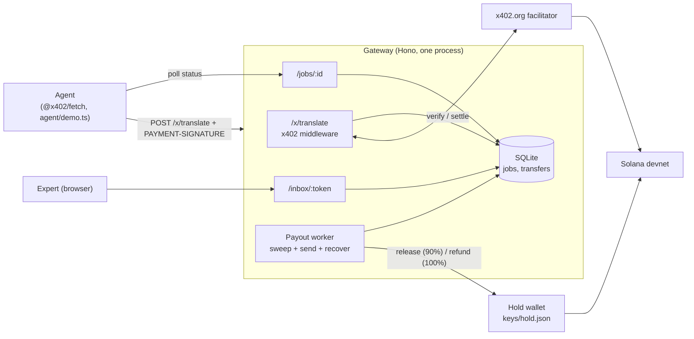

# HumanRoute

An AI agent that is unsure about a translation can pay a human expert $0.50 in USDC, per question, over HTTP using x402 on Solana devnet. The gateway holds the payment. If the expert answers inside the SLA (default 60 s), 90% is released to the expert. If the expert stays silent, the agent gets a full refund. Both outcomes are ordinary on-chain USDC transfers. This is a hackathon demo and runs on devnet only.

## Architecture



Payment goes to the hold wallet. A job row is created only after settlement, keyed by the settlement signature. The worker then decides per job: answered in time, release `PRICE - FEE_PCT` to the expert; past the deadline, refund the full price to the payer. Job state (the decision) and transfer status (`pending -> sent -> confirmed | failed`) are tracked separately.

## Run from a clean clone

Requires Node 22+.

1. Install:

   ```
   npm ci
   ```

2. Create the devnet wallets (`keys/hold.json`, `keys/agent.json`, `keys/expert.json`), airdrop SOL where possible and create the USDC token accounts. It is idempotent.

   ```
   npm run setup:wallets
   ```

3. Fund the **agent** wallet with devnet USDC (mint `4zMMC9srt5Ri5X14GAgXhaHii3GnPAEERYPJgZJDncDU`) at <https://faucet.circle.com> (pick Solana, Devnet). The script prints the agent address. The hold wallet needs devnet SOL for fees. The airdrop is rate limited, so top up from <https://faucet.solana.com> if the script reports a failure.

4. Configure:

   ```
   cp .env.example .env
   ```

   `.env.example` has two groups of names. The gateway (`src/config.ts`) reads `RPC_URL`, `HOLD_KEYPAIR_PATH`, `EXPERT_WALLET`, `INBOX_TOKEN`, `PRICE_USDC`, `FEE_PCT`, `SLA_SECONDS`, `PORT`, `DB_PATH`. `scripts/setup-wallets.ts` and the agent read `SOLANA_RPC_URL`, `HOLD_KEYPAIR`, `AGENT_KEYPAIR`, `EXPERT_KEYPAIR`. Set `INBOX_TOKEN` to something other than `change-me`. `EXPERT_WALLET` may stay empty: the gateway then uses the public key of `keys/expert.json`.

5. Start the gateway (loads `.env`):

   ```
   npm run dev
   ```

6. In a second terminal, run the agent demo. It translates a 3-clause contract with a fake MT and escalates the least confident clause.

   - Answered mode: `npm run demo`. Open the printed `/inbox/<INBOX_TOKEN>` link, open the job and submit a translation within `SLA_SECONDS`. The expert payout confirms and the answer comes back to the agent.
   - Silent mode: `npm run demo:silent`. Nobody answers. After `SLA_SECONDS` the worker refunds the agent and the demo prints `refund [confirmed] <explorer link>`.

7. Checks: `npm run typecheck`, `npm test`, and `scripts/e2e.sh` (real devnet run of silent mode: starts the server, expects a confirmed refund within SLA+90 s; exits 0 with a message if `keys/` or `.env` is missing).

## The 402, with curl

```
curl -si -X POST http://localhost:4021/x/translate \
  -H 'content-type: application/json' \
  -d '{"text":"hi","sourceLang":"en","targetLang":"de"}'
```

The response is `HTTP/1.1 402 Payment Required` with a `payment-required` header. Decode it:

```
curl -si -X POST http://localhost:4021/x/translate \
  -H 'content-type: application/json' \
  -d '{"text":"hi","sourceLang":"en","targetLang":"de"}' \
  | grep -i '^payment-required' | cut -d' ' -f2 | tr -d '\r' | base64 -d | jq
```

Captured from this repo on devnet config (default `.env.example` values, hold wallet of this machine's `keys/hold.json`; `payTo` and `feePayer` differ on your clone):

```json
{
  "x402Version": 2,
  "error": "Payment required",
  "resource": {
    "url": "http://localhost:4099/x/translate",
    "description": "Human translation job",
    "mimeType": "application/json"
  },
  "accepts": [
    {
      "scheme": "exact",
      "network": "solana:EtWTRABZaYq6iMfeYKouRu166VU2xqa1",
      "amount": "500000",
      "asset": "4zMMC9srt5Ri5X14GAgXhaHii3GnPAEERYPJgZJDncDU",
      "payTo": "GA2zTLgnzac8zdr2VZBLC7FchaLJbz3MARnzBRkdUFmr",
      "maxTimeoutSeconds": 300,
      "extra": { "feePayer": "CKPKJWNdJEqa81x7CkZ14BVPiY6y16Sxs7owznqtWYp5" }
    }
  ]
}
```

`amount` is in USDC base units (6 decimals): 500000 = $0.50. An agent using `@x402/fetch` signs a transfer matching this and retries with a `PAYMENT-SIGNATURE` header; the gateway answers `202` with `jobId`, `statusUrl` and `statusToken`.

Spike data: `spike/REPORT.md` and `spike/fixtures/` do not exist in this checkout (`spike/` is empty), so this README quotes no spike signatures or timings. Real signatures and timings appear in the output of `npm run demo` / `npm run demo:silent` as explorer links.

## Failure handling

Behaviour is taken from `src/routes/x.ts`, `src/worker.ts`, `src/db.ts` and the tests. "Test" means covered by `test/`.

| Case | What happens | Test |
| --- | --- | --- |
| No payment | `402` with `payment-required` header; nothing is charged | yes |
| Invalid body | `400` before any 402, so a bad request is never charged. An empty unpaid POST is a price probe and gets the 402 | yes |
| Replayed `PAYMENT-SIGNATURE` | Recognised by a hash of the transaction message; returns the same job as `202` with no second settle or job. The seen-map is in memory, so after a restart the DB unique `pay_tx` still prevents a second job. A concurrent replay gets `409` | yes (in-memory case) |
| Underpayment | Handled by the x402 middleware and the facilitator's verify step, which rejects it so no job is created. Not verified by a test here | no |
| Expert silent past SLA | The sweep marks the job `refunded` and queues one full refund (`PRICE_USDC`) to the payer; the worker sends it | yes |
| Late answer | Inbox answer is accepted only while the job is `paid` and before its deadline (atomic in `db.answerJob`), otherwise `409`; the job is refunded | yes |
| RPC failure during payout | A failed send leaves the transfer `pending` and it is retried on the next tick (every 2 s) without a second decision | yes |
| Restart after send | On startup the worker re-checks every `sent` transfer by signature and never resends one that may still land. Only a signature unseen for 120 s is reset to `pending` and resent | yes |

One transfer per job is enforced by a unique index on `transfers.job_id`.

## Custody and devnet-only disclosure

- This is a **demo on Solana devnet**. Do not use it with real funds or on mainnet.
- Custody is a **hot hold keypair** (`keys/hold.json`) on the server. Whoever has that file controls the held USDC. `keys/` is git-ignored.
- The expert inbox is a **magic link** (`/inbox/<INBOX_TOKEN>`), a single shared secret. It is demo-only auth, not a real identity or login system. The job status link is protected only by its per-job token.
- Escrow, multisig or on-chain program custody, and real expert identity are post-hackathon work. Today the gateway operator is trusted to pay out and refund correctly. The transfers are on-chain and auditable, but not enforced by a program.

## Why x402 + Solana

1. HTTP-native pay-per-call: no accounts, API keys or subscriptions. A `402` and a retry is the whole integration.
2. Agents can pay on their own, with a wallet and no human in the loop.
3. Finality in about 400 ms and sub-cent fees make $0.50 micro-jobs sensible.
4. USDC pricing: the price is stable and quoted in dollars.
5. Payouts and refunds are ordinary on-chain transfers that anyone can audit.
